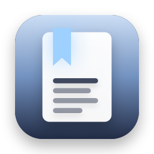
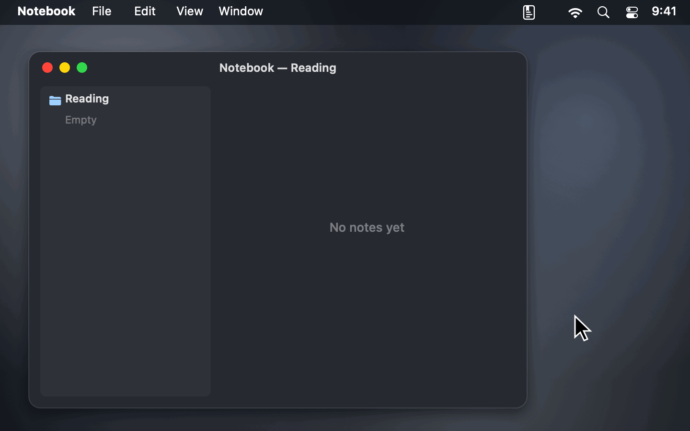
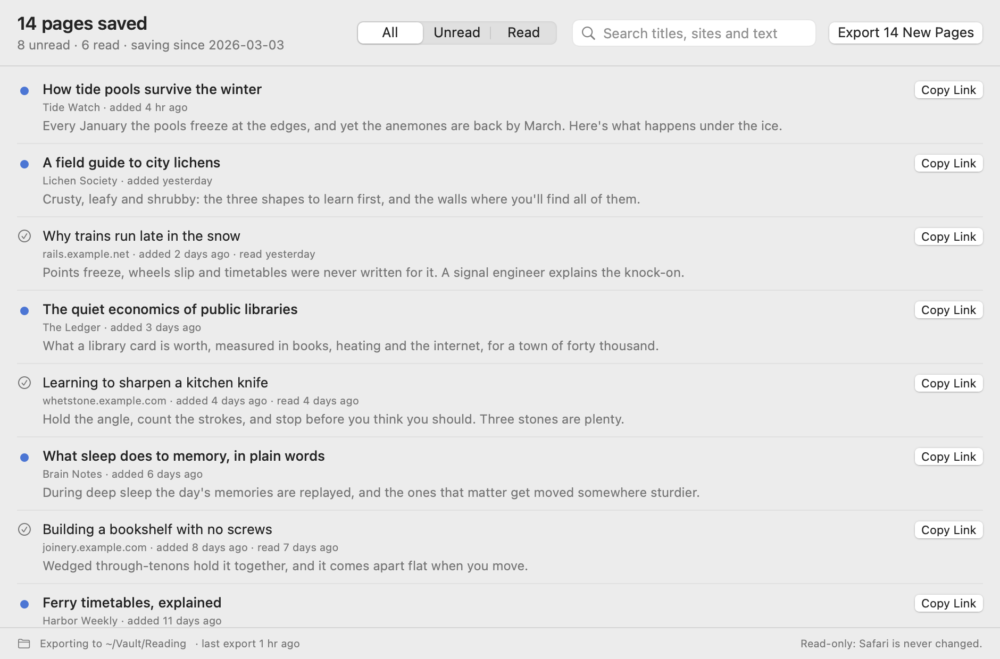
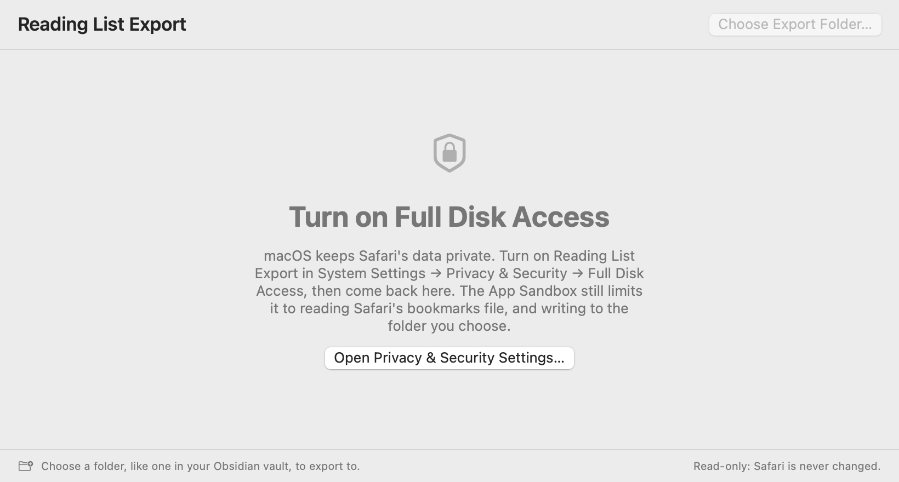

<p align="center">
  
</p>

<h1 align="center">Reading List Export</h1>

<p align="center">
  <b>Your Safari Reading List as Markdown, bookmarks and CSV.</b><br>
  A free, open-source menu bar app that exports every page you've saved to Safari's Reading List, read or unread, as a Markdown checklist, a bookmarks file read-later apps import, an Instapaper-style CSV and JSON.
</p>

<p align="center">
  <a href="https://github.com/stanczykwyatt/reading-list-export/releases/latest/download/Reading-List-Export.zip"><b>Download for Mac</b></a>
  &nbsp;·&nbsp;
  <a href="https://stanczykwyatt.github.io/reading-list-export/">Website</a>
  &nbsp;·&nbsp;
  <a href="https://github.com/users/stanczykwyatt/projects/1">Roadmap</a>
  &nbsp;·&nbsp;
  <a href="https://github.com/stanczykwyatt/reading-list-export/discussions">Discussions</a>
</p>

<p align="center">
  <a href="https://github.com/stanczykwyatt/reading-list-export/actions/workflows/ci.yml"></a>
  <a href="https://github.com/stanczykwyatt/reading-list-export/releases/latest"></a>
  
  
  
  
  <a href="LICENSE"></a>
</p>

<p align="center">
  
</p>

---

Safari's Reading List is easy to fill and hard to get out of. Safari's own Export Bookmarks gives you, at most, a plain list of links: no read or unread status, no previews, nothing for your notes, and nothing that keeps up as you save more. If you've been saving links for years, or you're one of the many people who left Pocket when it shut down in July 2025 and need a new home for your reading, there's no simple way to move that list into Wallabag, Linkding, Readwise Reader, Karakeep or your notes.

Reading List Export fixes that. Choose **Save as Bookmarks File…** and you have a file to import anywhere. Or pick a folder, like one in your Obsidian vault, and it keeps that folder up to date with your whole Reading List: a Markdown note with unread pages as open tasks and read ones checked off, a bookmarks file, and a CSV in Instapaper's layout. Run it again and only what's new is added.

It also keeps what Safari forgets. When you clear a page from your Reading List, it's gone from Safari for good. Once Reading List Export has exported it, it stays in the export, marked with when it left Safari.

It only reads Safari's bookmarks file, never changes it, and has no internet access. It's open source, so you can check exactly what it does.

If it helps you move your reading, [starring the repo](https://github.com/stanczykwyatt/reading-list-export/stargazers) helps other people find it.

<picture>
  <source media="(prefers-color-scheme: dark)" srcset="docs/screenshot-dark.png">
  
</picture>

## Features

- **Every page in your Reading List,** with its title, address, site, the date you added it, the preview text Safari saved, and whether you've read it.
- **A bookmarks file for read-later apps.** `Reading List.html` is the format every browser exports, in a Reading List folder. Linkding, Karakeep, Raindrop.io, Firefox and Chrome import it, and Linkding keeps unread pages unread.
- **An Instapaper-style CSV.** `Reading List.csv` has Instapaper's columns, with unread pages in Unread and read ones in Archive, which Wallabag's and Readwise Reader's Instapaper imports take.
- **A Markdown checklist.** `Reading List.md` lists unread pages as open tasks and read ones checked off, with each page's preview below it. Front matter and tags make it Obsidian-friendly.
- **A note for each page,** if you'd rather keep them one by one, and `Reading List.json` with everything, for scripts.
- **Only what's new on each run.** A small record in the export folder remembers what's there, so nothing is duplicated, and recognizes pages iCloud gives new IDs.
- **Never forgets a page,** even after you clear it from Safari. Cleared pages are tagged in the bookmarks file and archived in the CSV, so they don't come back to your new app as unread.
- **Never overwrites your edits.** Edit a note and it's left alone from then on. Files you didn't write are never touched; new ones get their own names.
- **Search your Reading List** by any word in a page's title, site, address or preview, which Safari's sidebar can't do, and filter to unread or read.
- **Automatic export,** off until you turn it on.
- **A command line tool,** `reading-list-export`, for scripts and Shortcuts.
- **Read-only and offline.** Free, with no account, subscription, tracking or dependencies.

### What the note looks like

```markdown
---
title: "Reading List"
pages: 14
unread: 8
source: Safari Reading List
tags:
  - reading-list
---

# Reading List

8 unread · 6 read

## Unread

- [ ] [How tide pools survive the winter](<https://tidewatch.example.com/winter-pools>) · Tide Watch · added 2026-04-30
  > Every January the pools freeze at the edges, and yet the anemones are back by March.
- [ ] [A field guide to city lichens](<https://lichens.example.org/city-guide>) · Lichen Society · added 2026-04-29

## Read

- [x] [Why trains run late in the snow](<https://rails.example.net/snow-delays>) · rails.example.net · added 2026-04-28 · read 2026-04-29
```

The export folder ends up with `Reading List.md`, `Reading List.html` and `Reading List.csv`, plus `Reading List.json` and a `Pages` folder if you turn them on.

### Where to import it

| App | File | How |
|---|---|---|
| Linkding | `Reading List.html` | Settings → General → Import. Unread pages stay unread, with the `reading-list` tag. |
| Karakeep, Raindrop.io, Readeck | `Reading List.html` | Their import from browser bookmarks, or a Netscape bookmarks file. |
| Wallabag | `Reading List.csv` | Import → Instapaper. Read pages come in archived. |
| Readwise Reader | `Reading List.csv` | Import → Instapaper. |
| Firefox, Chrome, Safari | `Reading List.html` | Import Bookmarks. Pages land in a Reading List folder. |
| Obsidian, Logseq, any notes app | `Reading List.md` | Pick a folder in your vault as the export folder. |

Each app's import changes now and then, so check its own help if a menu has moved.

### What it can't do

- **Tab Groups aren't exported yet.** Safari keeps them in a separate database. They're on the [roadmap](https://github.com/users/stanczykwyatt/projects/1) for the next version.
- **No full article text.** Safari can save pages for offline reading, but those archives are its own. You get the preview text Safari shows under each title, not the whole page.
- **Only what Safari on this Mac has.** Pages you save on your iPhone or iPad appear once iCloud syncs them to Safari here. Turn on Safari in **System Settings → Apple Account → iCloud** on each device.
- **Safari keeps one read date,** the last time you opened a page, and forgets it if you mark the page unread.

## Install

1. [Download **Reading-List-Export.zip**](https://github.com/stanczykwyatt/reading-list-export/releases/latest/download/Reading-List-Export.zip) and unzip it.
2. Move **Reading List Export** to your Applications folder and open it.
3. Turn on Full Disk Access when it asks: **System Settings → Privacy & Security → Full Disk Access**, then switch on Reading List Export. The window has a button that opens the right page.
4. Choose **Save as Bookmarks File…** or **Choose Export Folder…** from its menu bar icon.

It turns on Open at Login the first time it runs, like most menu bar apps; switch it off in the menu.



> **Why Full Disk Access?** macOS keeps Safari's data in a protected folder that no other app can read without it. Reading List Export's App Sandbox still limits it to one file there, Safari's bookmarks file, read-only, plus the export folder you choose. Your history, open tabs, passwords and the rest of your disk stay out of reach even with Full Disk Access on. [SECURITY.md](SECURITY.md) has the details.

> **About the security warning:** The first time you open Reading List Export, macOS may say Apple couldn't verify that it's free of malware. It shows up because the app isn't notarized yet: Apple charges developers $99 a year for that, and this project hasn't paid the fee. The code is fully open source, so you can read every line or build the app yourself. To open it, go to **System Settings → Privacy & Security** and click **Open Anyway**.

> **Can't see the icon?** On a MacBook with a camera notch, menu bar icons that don't fit are hidden behind it. Hold ⌘ and drag the icon to the right, or quit a menu bar app you don't need.

### Build from source

You need macOS 14 or later and Swift 6, which comes with Xcode 16 or the Command Line Tools.

```bash
git clone https://github.com/stanczykwyatt/reading-list-export.git
cd reading-list-export
scripts/build-app.sh
open "build/Reading List Export.app"
```

That also builds the command line tool as `build/reading-list-export`.

## How to use it

| To | Do this |
|---|---|
| Move your Reading List to another app | Menu → Save as Bookmarks File… (⌘S), then import the file there |
| Export what's new | Menu → Export New Pages (⌘E) |
| Export as you save pages | Menu → Export Automatically |
| Find a page | Menu → Open Reading List Export…, then type in the search field |
| Copy a page's link | Menu → Recently Added, or Copy Link in the window |
| Choose what's written | Menu → Export Options: Markdown, bookmarks file, CSV, JSON, a note for each page |
| Change the export folder | Menu → Export Folder → Choose Another Folder… |
| Stop it opening at login | Menu → turn off Open at Login |

### The command line tool

```bash
reading-list-export list --unread --limit 20     # your latest unread pages
reading-list-export bookmarks > ~/Desktop/"Reading List.html"
reading-list-export export ~/Notes/Reading --json
reading-list-export list --bookmarks-file ~/Backups/Bookmarks.plist
```

`reading-list-export --help` lists every option. It needs Full Disk Access for your terminal app, and like the app, it only reads Safari's bookmarks file and only writes into the folder you give it. `--bookmarks-file` reads a copy, like one from a Time Machine backup.

## Privacy and security

Reading List Export is built so it *can't* misuse your Safari data, not just so it promises not to.

- **One file, read-only.** The App Sandbox gives it read access to Safari's bookmarks file and nothing else in your home folder, not even the rest of Safari's folder, and blocks writing there. Inside that file it reads only the Reading List, not your other bookmarks.
- **Writes only where you say.** The one folder you choose, or the one file you save, through the standard macOS dialogs. Files already in the export folder are never overwritten, a file you save over is only replaced once the save dialog asks you, and it never deletes anything.
- **No internet access.** The app has no network entitlement, so it can't send anything anywhere, and it never fetches a page. CI checks every build for this.
- **No dependencies.** Every line that runs is in this repository.

Check the app's permissions yourself with `codesign -d --entitlements - "/Applications/Reading List Export.app"`. The full details are in [SECURITY.md](SECURITY.md), including what an ad-hoc signature means until releases have a Developer ID.

## FAQ

**How do I export my Safari Reading List?**
Safari's Export Bookmarks gives you a plain list of links at best, without what you've read or the previews. Open Reading List Export, choose Save as Bookmarks File… from its menu bar icon, and save the file. Or choose an export folder to get Markdown, a bookmarks file and a CSV, kept up to date.

**I left Pocket. Can I move my Safari Reading List to Wallabag, Linkding or Readwise Reader?**
Yes. Linkding, Karakeep and Raindrop.io import `Reading List.html`. Wallabag and Readwise Reader import `Reading List.csv` through their Instapaper import. Read pages come in archived where the app supports it.

**Does it include pages I saved on my iPhone?**
Yes, once iCloud has synced them to Safari on this Mac. Safari on the Mac and on your iPhone share one Reading List when Safari is turned on in iCloud on both.

**Does it export Safari Tab Groups?**
Not yet. Tab Groups are kept in a different database from the Reading List, and they're planned for the next version.

**Will it change or delete anything in Safari?**
No. The App Sandbox only lets it read Safari's bookmarks file, and blocks it from writing there. Clearing pages from your Reading List doesn't delete anything from the export either.

**Can I edit the files it makes?**
Yes. A file you've changed is never overwritten. Reading List Export only updates files it made that you haven't touched. Delete a page's note and it stays deleted; delete `Reading List.md`, the bookmarks file or the CSV and the next export writes them fresh.

**What are `.reading-list-export.json` and `.reading-list-export.lock`?**
The first is Reading List Export's record of what it has exported to the folder: every page so far, and what each file held when it was written. It's how pages you clear from Safari stay in the export, so keep it with the folder. The second is empty and keeps two exports into the same folder from running at once. Both are hidden.

**Does it work on Intel Macs?**
Yes. The download runs on Apple silicon and Intel Macs with macOS 14 Sonoma or later.

## More free Mac utilities

- **[Show Desktop](https://github.com/stanczykwyatt/show-desktop):** hide every window with one click or ⌃⇧D, then bring them all back exactly as they were.
- **[Copy 2FA](https://github.com/stanczykwyatt/copy-2fa):** copy 2FA codes from Mail, Messages or a built-in authenticator with one keyboard shortcut.
- **[Who Stole My Focus](https://github.com/stanczykwyatt/who-stole-my-focus):** find out which app keeps jumping in front of your work.
- **[AI Footprint](https://github.com/stanczykwyatt/ai-footprint):** see what AI coding tools leave on your Mac, and what each update changed.
- **[Memo Export](https://github.com/stanczykwyatt/memo-export):** export your Voice Memos transcripts as Markdown, with the audio.
- **[Podcast Export](https://github.com/stanczykwyatt/podcast-export):** export your Apple Podcasts shows as OPML, and your listening history.

All seven have no internet access.

## Contributing

Contributions are welcome, especially reports of pages it read wrong, and read-later apps whose import doesn't take one of the files. See [CONTRIBUTING.md](CONTRIBUTING.md), and the [roadmap](https://github.com/users/stanczykwyatt/projects/1) for what's planned. Ideas go in [Discussions](https://github.com/stanczykwyatt/reading-list-export/discussions).

## License

Reading List Export is released under the [MIT License](LICENSE) and is provided as is, without warranty of any kind.

Reading List Export is an independent project. It isn't affiliated with, endorsed by or sponsored by Apple Inc., Pocket, Instapaper, Obsidian, or the makers of any app named here. Apple, Mac, macOS, Safari, iPhone, iPad and iCloud are trademarks of Apple Inc., registered in the U.S. and other countries. Other product names belong to their owners and are used only to say what the app works with. The pages, sites and notes app in the screenshots and demo are made up.
